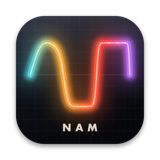
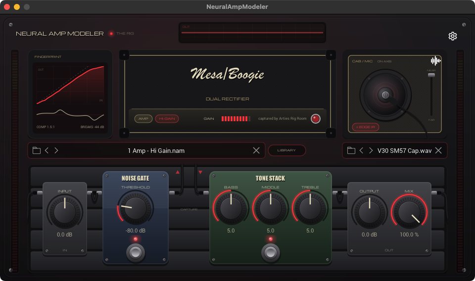

# The Rig: a redesigned Neural Amp Modeler

**The Rig** is a new interface for Neural Amp Modeler, designed by Starquake Music. It reads each capture's metadata and draws the gear it came from (amp head, combo, stompbox or rack), coloured by its tone. It also adds:

- a fingerprint of each capture's gain curve
- a live scope of the output
- a cab with a movable mic
- a pedalboard for the noise gate, EQ and levels
- a capture library that browses a folder of `.nam` files as cards

The sound engine is the official Neural Amp Modeler 0.8.0, unchanged.

### Download

**[Download the latest macOS build](https://github.com/StarquakeMusic/NeuralAmpModelerPlugin/releases/latest)**: standalone app, VST3 and Audio Unit, for Apple Silicon (macOS 11+) and Intel (macOS 10.15+). The zip includes `THE_RIG_GUIDE.html`, a guide to installing and using it.

Good to know:

- The builds aren't notarized by Apple. After copying them into place, clear the quarantine flag (for example `xattr -dr com.apple.quarantine ~/Library/Audio/Plug-Ins/VST3/NeuralAmpModeler.vst3`); the guide lists every step.
- The Rig uses the same plugin ID as the official Neural Amp Modeler, so installing it replaces the official version. Sessions open in either one.
- Only macOS builds are available.

The original plugin is by Steven Atkinson and contributors. Everything below is the original README.

---

# Neural Amp Modeler Plug-in

A VST3/AudioUnit plug-in\* for [Neural Amp Modeler](https://github.com/sdatkinson/neural-amp-modeler), built with [iPlug2](https://iplug2.github.io).

- https://www.youtube.com/user/RunawayThumbtack
- https://github.com/sdatkinson/neural-amp-modeler

## Building and Installation

To build the app or plugin, there are build scripts in [NeuralAmpModeler/scripts/](https://github.com/sdatkinson/NeuralAmpModelerPlugin/tree/main/NeuralAmpModeler/scripts).
The [workflows](https://github.com/sdatkinson/NeuralAmpModelerPlugin/tree/main/.github/workflows) can show you how to do this.

### Pre-built installers

If you want a pre-built installer from this repo without having to , I've made "Gateway", a fork of this repo, availble at https://neuralampmodeler.com/users!

## Supported Platforms

The Neural Amp Modeler plugin currently supports Windows 10 (64bit) or later, and macOS 10.15 (Catalina) or later.

For Linux support, there is an LV2 plugin available: https://github.com/mikeoliphant/neural-amp-modeler-lv2.

## About

This is a cleaned up version of [the original iPlug2-based NAM plugin](https://github.com/sdatkinson/iPlug2) with some refactoring to adopt better practices recommended by the developers of iPlug2.
(Thanks [Oli](https://github.com/olilarkin) for your generous suggestions!)

\*could also support AAX, CLAP, Linux, iOS soon.

## Rough edges

### Standalone I/O
The I/O for the standalone doesn't inherit the stability of most plugin hosts (DAWs), so it's a bit sparser on features. For complex routing, the plugin (VST3/AU) inside a plugin host is still the most reliable option.

### Graphics backend
If you're having trouble with NAM crashing before the GUI comes up, then you might have an unsupported graphics configuration. Usually, this is when you have a dedicated graphics card (like an nVIDIA GPU) and you're using the integrated (CPU) graphics on a Windows system. To fix this, Go to the control panel, pick NAM (or your DAW), and make sure that it uses your graphics card. (If you know more and can help fix this, please make an Issue and let me know more!)
